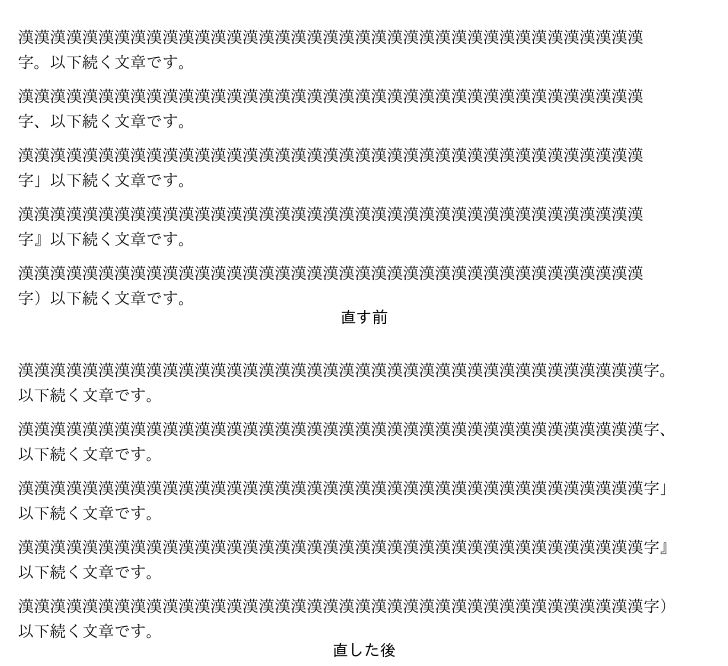
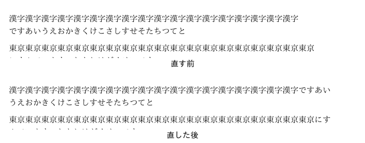
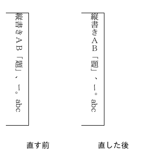
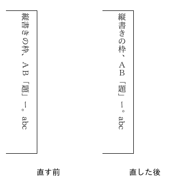
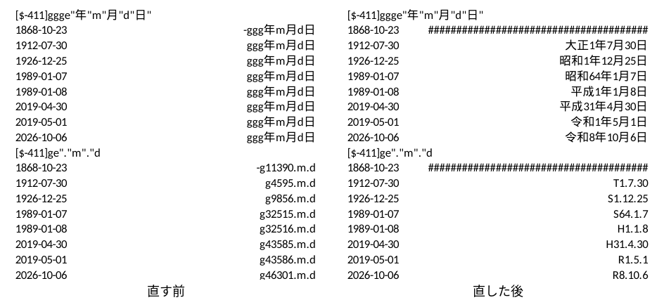

# ja-office-fixes

Euro-Office の文書エディターと表計算で、日本語の行の折り返し・縦書き・和暦・関数・漢数字・書体を直すパッチです。
パッチを当てた Euro-Office 9.3.6(Linux 版、Windows 版、Mac 版)を、[Releases](https://github.com/aiseed-dev/ja-office-fixes/releases) から
ダウンロードできます。
同じパッチは、Euro-Office の元になった ONLYOFFICE にも当たります([参考: ONLYOFFICE に当てる](#参考-onlyoffice-に当てる))。
Euro-Office と ONLYOFFICE(Ascensio System SIA)のどちらとも関係のない、独自の取り組みです。

[English](#english)

## ダウンロード(Euro-Office)

パッチを当てた Euro-Office 9.3.6 は、このリポジトリの [Releases](https://github.com/aiseed-dev/ja-office-fixes/releases) から
ダウンロードできます。組み立ては要りません。GitHub Actions(`.github/workflows/euro-office-release.yml`)が、
公式の版にパッチを当てて作ります。

| ファイル | 使う所 |
|---|---|
| `ja-office-fixes-euro-office-9.3.6-linux-x86_64.flatpak`(`-linux-aarch64`) | Flatpak の使える Linux |
| `ja-office-fixes-euro-office_9.3.6-0+ja<日付>_amd64.deb`(`_arm64.deb`) | Ubuntu、Debian |
| `ja-office-fixes-euro-office-9.3.6-linux-x86_64.tar.xz`(`-linux-aarch64`) | ほかの Linux |
| `ja-office-fixes-euro-office-9.3.6-windows-x64.zip`(`-windows-arm64`) | Windows |
| `ja-office-fixes-euro-office-9.3.6-macos-arm64.zip` | Mac(Apple シリコン) |

- Flatpak: `flatpak install --user ./ja-office-fixes-euro-office-9.3.6-linux-x86_64.flatpak` で入れます。
  ファイルをダブルクリックして、「ソフトウェア」から入れることもできます。土台(org.freedesktop.Platform 26.08)は
  Flathub から入ります。公式の Euro-Office とは別のアプリとして入るので、両方を使えます。
  自動では新しい版になりません。新しい版は、新しいファイルを入れ直します。
- Ubuntu、Debian: `sudo apt install ./ja-office-fixes-euro-office_*.deb` で入れます。メニューに Euro-Office が出て、
  文書をダブルクリックで開けます。公式の Euro-Office の .deb と同じ場所に入るので、公式の版と入れ替わります。
  公式の版に戻すときは、公式の .deb を入れ直します。
- ほかの Linux: tar.xz を展開したフォルダーの `ja-office-fixes` を実行します。
- Windows: 展開したフォルダーの `DesktopEditors.exe` を実行します。
- Mac: 展開した「Office (Euro-Office).app」を「アプリケーション」に入れます。この Mac 用の署名ではないので、
  初めの 1 回は、ターミナルで `xattr -dr com.apple.quarantine "/Applications/Office (Euro-Office).app"` を実行してから開きます。
- Mac 版と、arm(aarch64、arm64)の版は、まだ実際の機械で動かしていません。

ダウンロードは、Euro-Office の公式の版ではありません。中の `JA-OFFICE-FIXES.txt` に、変えた所、日付、元のコードの場所を書いています。

## 何を直すか

### 行の折り返し

- 仮名の間で行を折ります。公式の版は、仮名の続きを 1 語として扱い、まとめて次の行へ送ります。
  そのため、行が早く終わります。
- 行の頭に置けない字(「。」「、」「」」など)が行に入らないときは、その字を 1 字だけ行末に
  はみ出させて置きます(追い込み)。Word と同じ形です。公式の版は、前の字ごと次の行へ送るので、
  1 行の字の数が Word より 1〜2 字少なくなり、様式の行数やページ数が変わります。
- 行の頭に置けない字に、Word の禁則の「標準」の字(・、々、ゝゞヽヾ、゛゜、℃、半角の ｡｣､･ﾞﾟ)を足します。
  小書きの仮名と長音は、Word の「標準」と同じく行の頭に置けます。





### 縦書き

表のセルの縦書き(docx の `w:textDirection="tbRl"`)と、テキストボックスの縦書き(`vert="eaVert"`)で、
漢字・仮名・全角の英数字を立てて描きます。公式の版は、すべての字を横倒しにします。
括弧・長音・欧文は、Word と同じく回したままにします。「、」「。」は字の枠の右上に寄せます。

 

### 和暦(表計算)

日本の Excel の和暦の表示形式で、日付を和暦で表示します。
`[$-411]ggge"年"m"月"d"日"` は「令和8年10月6日」、`[$-411]ge.m.d` は「R8.10.6」になります。
日本の Excel の組み込みの日付の表示形式も、この書き方です。
公式の版は、「ggg年m月d日」や「g46301.m.d」のように表示が壊れます。

- `g` は元号の頭文字(R)、`gg` は元号の 1 字目(令)、`ggg` は元号(令和)です。
- `e` は元号の年、`ee` は 2 桁の元号の年です。`r` は `ee`、`rr` は `gggee` と同じです。
- 表示形式に `[$-411]` が無いときは、ブックの言語が日本語の場合に和暦にします。
- 表示形式の「G/標準」を、「標準」として扱います。
- 日本の Excel が「元年」の表示に使う `[$-ja-JP-x-gannen]` では、元号の最初の年を「元」と表示します(令和元年5月1日)。
  Excel と同じく、元号を漢字で書く(`gg` か `ggg`)ときだけで、`ge.m.d` は「R1.5.1」のままです。



### 日本語の関数(表計算)

| 関数 | 公式の版 | 直した後 |
|---|---|---|
| `ASC("エクセル")` | エクセル(変わらない) | ｴｸｾﾙ |
| `ASC("ｱｲｳ")` | 制御文字になる | ｱｲｳ(変わらない) |
| `JIS("ｴｸｾﾙ")` | ｴｸｾﾙ | エクセル |
| `JIS("あいう")` | 別の字になる | あいう(変わらない) |
| `LENB("あいう")` | 3 | 6 |
| `LEFTB("あいう",2)` | あい | あ |
| `VALUE("１２３")` | #VALUE! | 123 |
| `NUMBERSTRING(1234,1)` | #NAME? | 千二百三十四 |
| `NUMBERSTRING(1234,2)` | #NAME? | 壱阡弐百参拾四 |
| `NUMBERSTRING(1234,3)` | #NAME? | 一二三四 |
| `DATESTRING("2026/10/6")` | #NAME? | 令和08年10月06日 |
| `YEN(1234.567)` | ¥1,234.57 | ¥1,235 |
| `PHONETIC(A1)`(A1 は「やまだ」) | #NAME? | ヤマダ |
| Excel の文書の `JIS(A1)` | #NAME? | A1 を全角にした字 |

- ASC と JIS は、英数字・記号・スペース・片仮名の全角と半角を変えます。濁点の付いた字は、全角の 1 字と半角の 2 字(ガ、ｶﾞ)で変わります。
- LENB・LEFTB・RIGHTB・MIDB・REPLACEB・FINDB・SEARCHB は、日本語の文字コード(シフト JIS)のバイトで数えます。
  英数字と半角の片仮名は 1 バイト、ほかの字は 2 バイトです。2 バイトの字の途中で切れるときは、その半分をスペースにします。
- VALUE は、全角の数字と記号も読みます。
- NUMBERSTRING は、数を整数に丸めて漢数字にします。2 番目の引数の 1 は「千二百三十四」、2 は「壱阡弐百参拾四」、3 は「一二三四」です。
  表示形式の `[DBNum1]` と `[DBNum2]` と同じ字を使います。
- DATESTRING は、日付を「令和08年10月06日」の形の和暦にします。
- YEN は DOLLAR の日本語の名前です。文書の中では DOLLAR です。数を丸めて「¥1,235」の形にします。
  2 番目の引数は小数の桁数で、省くと 0 です。負の数は「¥-1,235」です。
- PHONETIC は、セルのふりがなを返す関数です。ふりがなは読み込まれないので、セルの文字列を返します。
  Excel と同じく、平仮名と半角の片仮名は全角の片仮名にします。Excel も、ふりがなの無いセルではこうします。
- JIS は、文書の中では DBCS という名前です。公式の版は JIS の名前で保存していたので、Excel では `#NAME?` になりました。
  Excel の文書の DBCS も、公式の版では `#NAME?` でした。今は、文書の中は DBCS で、画面では JIS です。
- これらの関数の答えは、Windows の Excel(日本語)で確かめました。

### 漢数字(表計算)

表示形式の `[DBNum1]`・`[DBNum2]`・`[DBNum3]` で、数と日付を漢数字で表示します。
ECMA-376 には定めが無いので、日本語の環境の Excel(Mac の Excel 16.113)の表示に合わせました。
公式の版は、`[$-411]` の付いた `[DBNum1]` だけを 1 字ずつ替え、`[DBNum2]` と `[DBNum3]` は算用数字のままです。

| 表示形式 | 1234 | 12345 | 2026 年 10 月 8 日 |
|---|---|---|---|
| `[DBNum1]General` | 千二百三十四 | 一万二千三百四十五 | — |
| `[DBNum2]General` | 壱阡弐百参拾四 | 壱萬弐阡参百四拾伍 | — |
| `[DBNum3]General` | 千２百３十４ | １万２千３百４十５ | — |
| `[DBNum1]#,##0` | 一,二三四 | 一二,三四五 | — |
| `[DBNum1][$-411]ggge"年"m"月"d"日"` | — | — | 令和八年十月八日 |
| `[DBNum1]yyyy"年"m"月"d"日"` | — | — | 二〇二六年十月八日 |

- 「標準」(General)と組むと、位取りで書きます。`[DBNum1]` と `[DBNum3]` は、十・百・千の前の「一」を書きません(百五、千)。
  `[DBNum2]` は大字で、「壱拾」のように書きます。小数は 1 字ずつ書きます。
- ほかの数の表示形式と組むと、数字を 1 字ずつ替えます。桁区切りと四捨五入は、表示形式のとおりです。
  `[DBNum1]0;"△"0` のように、`[DBNum1]` の無い区分の数は替えません。
- 日付と時刻は、`yyyy` と、0 で始まる欄(05 など)を 1 字ずつ、ほかの欄を位取りで書きます(十月、二十三時)。
  `[DBNum3]` は数字を全角にするだけです(令和８年１０月８日)。
- 表示形式に `[$-411]` が無いときは、ブックの言語が日本語の場合に替えます。

### 日本語の書体(文書)

Office のテーマは、東アジアの書体(`<a:ea>`)を空にして、日本語の書体を `<a:font script="Jpan">` に書きます。
公式の版はこの一覧を読み飛ばすので、テーマの書体を使う日本語の文が、欧文の書体や中国語の書体で表示されます。

- テーマの書体の一覧を読み、日本語の文には `Jpan` の書体を使います(テーマが游明朝なら游明朝)。
  韓国語は `Hang`、中国語は `Hans` と `Hant` の書体を使います。
- Word は、どの言語の書体を使うかを `w:themeFontLang` で決めます(ECMA-376 Part 1, 17.15.1.88)。
  この設定は変換器(core)から sdkjs に渡らないので、代わりに文字の言語(`w:lang` の `eastAsia`)で決めます。
  日本語の Word で作った文書では、どちらも `ja-JP` です。
- 保存するときも、テーマの書体の一覧を残します。
- 段落の詳細設定の「フォント」タブに、「日本語用のフォント」と「英数字用のフォント」の欄を足しました。
  Word のフォントのダイアログと同じく、片方だけを変えられます(`w:eastAsia` と、`w:ascii`・`w:hAnsi`)。
  選んだ範囲に書体が 2 つ以上あるときは、欄が空になります。
- ＭＳ ゴシックとＭＳ 明朝が手元に無いときは、英数字を BIZ UDゴシックと BIZ UD明朝で表示します(入っているときだけ)。
  ＭＳ ゴシック・ＭＳ 明朝の英数字はすべて全角の半分の幅で、BIZ UDゴシック・BIZ UD明朝も同じ幅です。
  そのため、英数字の多い行も Word と同じ幅になります。
  漢字とかなは、今までどおりエディターが選ぶ書体です(Mac では Arial Unicode MS。幅と字の形がＭＳ ゴシックに近い書体です)。
  文書に書く書体の名前は、ＭＳ ゴシックのままです。

### 日本語と英数字の間(文書)

Word は、漢字・かなと英字・数字の間を少し空けます(「日本語と英字の間隔を自動調整する」「日本語と数字の間隔を自動調整する」、
`w:autoSpaceDE` と `w:autoSpaceDN`)。文書で切っていなければ、どちらも有効です(ECMA-376 Part 1, 17.3.1.2、17.3.1.3)。
公式の版は空けません。

- 漢字・かなと、英字・数字が隣り合うところで、前の字の後ろを文字の大きさの 4 分の 1 空けます(四分アキ)。
- 空白、約物(「」、。など)、全角の英数字の隣は空けません。

## 自分で組み立てる(Euro-Office)

ダウンロードの代わりに、手元で公式の Euro-Office 9.3.6 にパッチを当てることもできます。
`build.py` の命令の後ろに `--target euro-office` を付けます。
Linux(x86_64 と arm64)、Mac(Apple シリコン)、Windows(x64 と arm64)で使えます。
Euro-Office の Mac 版は、Apple シリコン用だけです。

### 要る物

- git(Windows は Git for Windows)
- Python 3.12 以上
- Node.js(`node`、`npm`、`npx`。組み立てに使います)
- ディスクの空き 約 5.2GB(Linux)
- Linux: xdg-utils(ダブルクリックで開くアプリを設定するのに使います。無いときは、この設定だけを飛ばします)
- Windows: 長いパスを扱えるように、リポジトリはドライブの近く(`C:\src\ja-office-fixes` など)に置いてください。

### 組み立てる

```bash
git clone https://github.com/aiseed-dev/ja-office-fixes.git
cd ja-office-fixes
python3 build.py all --target euro-office
```

このコマンドは、次のことを順に行います。

1. Euro-Office のエディターのプログラム(sdkjs)、画面のプログラム(web-apps)、フォームの部品(sdkjs-forms)を、
   Euro-Office 9.3.6 が使っている版で GitHub から取ってきます。
2. 公式の Euro-Office 9.3.6 を GitHub から取ってきます。
   - Linux: euro-office-euro-office-9.3.6-0-x86_64.tar.xz(約 500MB。arm64 は aarch64.tar.xz)を `work/euro-office/desktop/` に展開します。
   - Mac: Euro-Office-DesktopEditors-9.3.6-0-macos-arm64.dmg(約 970MB)から、アプリを
     `~/Applications/Office (Euro-Office).app` に写します。
   - Windows: Euro-Office-DesktopEditors-9.3.6-0-windows-x64.zip(約 1GB。arm64 は windows-arm64.zip)を
     `work\euro-office\desktop\Euro-Office\` に展開します。
3. パッチを当てて、文書エディターと表計算のエディターと、文書エディターの画面を組み立てます。
   組み立てでは、npm の部品(約 115MB)を取ってきます。
4. 2 のアプリのエディターと画面を、組み立てた物に入れ替えます。
5. メニューに足します。
   - Linux: メニューに「ja-office-fixes (Euro-Office)」を足します(`~/.local/share/applications/ja-office-fixes-euro-office.desktop`)。
     文書(docx・doc・odt・rtf)をダブルクリックしたときに開くアプリも、これにします。
   - Mac: アプリは「アプリケーション」(ホームのフォルダーの中)にあります。docx を開くアプリの変え方を表示します。
   - Windows: スタートメニューに「ja-office-fixes (Euro-Office)」を足します。docx を開くアプリの変え方を表示します。

取ってきた物は、すべて `work/euro-office/` に入ります。2 回目からは取り直しません。
インストール済みの Euro-Office は書き換えません。

Mac では、アプリの中身を変えると公式の署名が合わなくなります。
そこで `build.py` は、この Mac だけで使う署名をし直し、ダウンロードの検疫の印を外します。
`~/Applications` に Euro-Office でない「Office (Euro-Office).app」があるときは、止まります。

Windows 版は、Windows 11(x64、日本語)の仮想マシンで確かめました。
Git for Windows、Python 3.13、Node.js 24 を入れて `python3 build.py all --target euro-office` を実行し、最後まで通りました。
パッチを当てたアプリで、禁則、日本語と英数字の間、表計算の関数が直っていることを画面で見ました。
Mac 版は、まだ実際の Mac で動かしていません。

### 使う

- 起動: メニューの「ja-office-fixes (Euro-Office)」(Mac は「Office (Euro-Office)」)か、`python3 build.py run --target euro-office 文書.docx`
- 直してあるのは文書(docx など)と表計算(xlsx など)です。プレゼンテーションは公式のままです。
- パッチを新しくする: `git pull` の後に `python3 build.py all --target euro-office`。パッチが変わっていれば当て直します。
  開いているときは、すべての窓を閉じてから、もう一度起動します。
- 公式のエディターに戻す: `python3 build.py restore --target euro-office`
- パッチを当てた物に戻す: `python3 build.py install --target euro-office`
- メニューから外す: `python3 build.py unmenu --target euro-office`。文書をダブルクリックしたときに開くアプリも、システムの既定に戻します。
  その後、このリポジトリのフォルダーを消せば、使うのをやめられます。
- ダウンロード用のファイルを作る: `python3 build.py package --target euro-office`(`dist/` にできます)

## 確かめ方

- `tests/documents/` の docx と xlsx を、直す前と直した後で印刷して比べました(上の画像は ONLYOFFICE で撮った物です)。
- Euro-Office 9.3.6 の Linux 版で、`tests/documents/` の文書を開き、直す前と後の画面を比べました。
  折り返し、禁則、セルとテキストボックスの縦書き、和暦、日本語の関数、日本語と英数字の間は、直した後の形になりました。
- sdkjs にもともとある組版の試験(段落・表・ハイフネーション・文字の組み立て・図の配置)を、node で回せるようにしました。
  パッチを当てても、すべて通ります。足した日本語の試験は、パッチの前は落ち、後は通ります。
- 表計算の表示形式と文字列の関数の試験も、node で回せます。和暦、日本語の関数、漢数字の試験を足しました。
  NUMBERSTRING、DATESTRING、YEN(DOLLAR)、PHONETIC の試験も足しました。答えは、Windows の Excel に計算させた値です。
  漢数字の試験の答えは、Mac の Excel に印刷させて確かめた値です。
- テーマの書体の試験と、英数字の書体の置き換えの試験を足しました(`tests/word/styles/themeFonts.js`、`latinFonts.js`)。

```bash
SDKJS=work/euro-office/sdkjs node tests/sdkjs_node/qunit.js work/euro-office/sdkjs/tests/word/document-calculation/paragraph/paragraph-lines.js
SDKJS=work/euro-office/sdkjs SDKJS_PRODUCT=cell node tests/sdkjs_node/qunit.js work/euro-office/sdkjs/tests/cell/spreadsheet-calculation/NumFormatParse.js
SDKJS=work/euro-office/sdkjs SDKJS_PRODUCT=cell node tests/sdkjs_node/qunit.js work/euro-office/sdkjs/tests/cell/spreadsheet-calculation/formula-tests/textAndDataTests.js
```

`SDKJS=` を付けないと、ONLYOFFICE の sdkjs(`work/sdkjs`)で回ります。

## まだ直していないこと

このリポジトリは、エディター(sdkjs と web-apps)だけを直します。変換器(core)に手を入れる必要のあることは、直していません。

- ページ全体の縦書き(縦書きの節)。docx から読む変換器(core)の段階で設定が消えるので、sdkjs だけでは直せません。
- 縦書きの「、」「。」は位置を寄せただけで、書体の縦書き用の字形は使っていません。
- ルビ、傍点、ふりがなの保存など。
- 漢数字の `[DBNum4]`。Excel でも表示が変わらなかったので、そのままです。
- 手元に無い書体の置き換え。Mac にはＭＳ ゴシックが無いので、テーマがＭＳ ゴシックの文は Arial Unicode MS で表示されます。
- 日本語と英数字の間の空きを切った段落(`w:autoSpaceDE="0"` など)。この設定は変換器(core)から sdkjs に渡らないので、
  切った段落も空きます。
- 日本語と英数字の間の空きの量と、行末の扱いは、まだ Word と比べていません。
  今は、行末の字の後ろの空きも、行に収まるかどうかに数えます。
- PHONETIC で、Excel で付けたふりがなを返すこと。ふりがなは変換器(core)で消えるので、sdkjs だけでは直せません。
- Euro-Office の Mac 版を、実際の Mac で動かすこと。

## 参考: ONLYOFFICE に当てる

同じパッチは、ONLYOFFICE Desktop Editors 9.4.0(sdkjs のタグ v9.4.0.129)にも当たります。
`build.py` は `--target` を付けないと ONLYOFFICE を扱います。
ONLYOFFICE の、手を入れた実行ファイルは配りません(下の「ライセンスと表示」)。利用者が公式の版を取り、手元でパッチを当てます。

### Linux

Linux(x86_64)、git、Python 3.12 以上、Node.js(`node` と `npx`)、ディスクの空き 約 3.8GB が要ります。

```bash
git clone https://github.com/aiseed-dev/ja-office-fixes.git
cd ja-office-fixes
python3 build.py all
```

- ONLYOFFICE のエディターのプログラム(sdkjs、約 320MB)、画面のプログラム(web-apps、約 1GB)、
  公式の Linux 版 9.4.0(約 345MB)を GitHub から取ってきて、`work/` で組み立て、入れ替えます。
- メニューに「ja-office-fixes」を足し、文書(docx・doc・odt・rtf)をダブルクリックしたときに開くアプリにします。
- インストール済みの ONLYOFFICE は書き換えません。残しておいても、別に動きます。
- 起動は、メニューの「ja-office-fixes」か `python3 build.py run 文書.docx` です。
- `restore`、`install`、`menu`、`unmenu` は、Euro-Office と同じに使えます(`--target` は付けません)。

### Mac

Mac(Apple シリコンか Intel)、git、Python 3.12 以上、Node.js、ディスクの空き 約 3.8GB が要ります。
`python3 build.py all` は、公式の Mac 版 9.4.0(ONLYOFFICE-arm.dmg か ONLYOFFICE-x86_64.dmg、約 550MB)から
アプリを `~/Applications/Office.app` に写し、名前を「Office」にして、パッチを当てた物に入れ替えます。

- ONLYOFFICE の名前は、手を入れた版の名前には使いません。起動した後の画面には、元が ONLYOFFICE であることが出ます。
- この Mac だけで使う署名をし直すので、ほかの Mac に写して使うことはできません。
- `/Applications/ONLYOFFICE.app` は書き換えません。ただし、設定と最近のファイルの一覧は、両方のアプリで共通です。
- 初めて起動すると、「アップデートを自動で確認しますか?」と聞かれます。
  「確認しない」を選んでください。自動で新しい版にすると、パッチの無い公式の版になります。
- 使わなくなったときは、`~/Applications/Office.app` をゴミ箱に入れて、このリポジトリのフォルダーを消します。

### Euro-Office との違い

- パッチは共通です(`patches/sdkjs/` と `patches/web-apps/`)。
  Euro-Office の sdkjs では、変える所の近くのコメントがロシア語のことがあります。
  そこで `git am -C1` で当てます。前後の文脈が 1 行ずつ合えば当たります。
- ONLYOFFICE 9.4.0 は、sdkjs を sdkjs の `build/build.py` で、web-apps を grunt で組み立てます。
  Euro-Office 9.3.6 は、どちらも webpack で組み立てます。
- Euro-Office の公式の文書エディターにはフォームの部品(sdkjs-forms)が入っているので、組み立てにも入れます。
- ONLYOFFICE の Windows 版には対応していません。

## ライセンスと表示

- パッチとスクリプトは GNU Affero General Public License v3.0(AGPL-3.0)です([LICENSE](LICENSE))。
  パッチは Euro-Office と ONLYOFFICE の sdkjs と web-apps(どちらも AGPL-3.0)に手を入れたものです。
- Euro-Office は、追加の条件の無い AGPL-3.0 です。パッチを当てた版を、Releases からダウンロードできるようにしています。
  Flatpak の版には、MIT Kerberos(krb5)も入っています。
- ONLYOFFICE is a trademark of Ascensio System SIA. このリポジトリは ONLYOFFICE の公式の物ではありません。
- ONLYOFFICE の、手を入れた実行ファイルは配りません。ONLYOFFICE の追加の条件は、ロゴを残すことを求め、名前を使う権利を与えていないためです。
- 1 つ目のパッチは、Yuito Murase さん(zeptometer)が ONLYOFFICE に出した
  [ONLYOFFICE/sdkjs#4885](https://github.com/ONLYOFFICE/sdkjs/pull/4885) と同じ直しに、試験を足したものです。

詳しくは [NOTICE.md](NOTICE.md) をご覧ください。

---

## English

Patches for the document and spreadsheet editors of Euro-Office 9.3.6 that fix Japanese line breaking, vertical
writing, dates in the Japanese era, Japanese text functions, Japanese numerals and the Japanese theme fonts.
Euro-Office with the patches can be downloaded for Linux, Windows and a Mac. The same patches apply to ONLYOFFICE
Desktop Editors 9.4.0, from which Euro-Office was forked. Not affiliated with Euro-Office or with Ascensio System SIA.

### Download (Euro-Office)

Euro-Office 9.3.6 with the patches can be downloaded from the
[Releases](https://github.com/aiseed-dev/ja-office-fixes/releases) of this repository, built from the official
release by GitHub Actions (`.github/workflows/euro-office-release.yml`):

- a `.flatpak` bundle (`flatpak install --user ./ja-office-fixes-euro-office-*.flatpak`; the runtime comes from
  Flathub, and it sits beside the official Euro-Office);
- a `.deb` for Ubuntu and Debian (`sudo apt install ./ja-office-fixes-euro-office_*.deb`; it takes the place of
  the official Euro-Office package);
- a `.tar.xz` for other Linux (run `ja-office-fixes` in the folder);
- a `.zip` for Windows (run `DesktopEditors.exe`);
- a `.zip` for a Mac with Apple silicon (move "Office (Euro-Office).app" to Applications and run
  `xattr -dr com.apple.quarantine "/Applications/Office (Euro-Office).app"` once).

The Mac and arm builds have not been run on real machines yet. They are not official Euro-Office builds;
JA-OFFICE-FIXES.txt in each says what was changed and where the source is.

### What is fixed

- Lines break between kana (they used to move to the next line as one word).
- A character that may not begin a line (。、」 …) hangs one character past the line end, as in Word,
  instead of pushing the character before it to the next line.
- Word's standard Japanese kinsoku characters are added to the "cannot begin a line" table.
- In vertical table cells (`tbRl`) and vertical text boxes (`eaVert`), ideographs, kana and
  full-width forms stand upright; brackets, dashes and Latin text stay turned with the line.
- Spreadsheet dates in the Japanese era: `[$-411]ggge"年"m"月"d"日"` shows 令和8年10月6日 and
  `[$-411]ge.m.d` shows R8.10.6, following ECMA-376 Part 1, 18.8.31 (g, gg, ggg, e, ee, r, rr).
  `G/標準` is read as General. With `[$-ja-JP-x-gannen]` the first year of an era is 元 where the era is
  written in kanji (令和元年5月1日), as in Excel.
- ASC and JIS convert full-width and half-width ASCII, spaces and katakana (ASC("エクセル") = ｴｸｾﾙ,
  JIS("ｴｸｾﾙ") = エクセル). LENB, LEFTB, RIGHTB, MIDB, REPLACEB, FINDB and SEARCHB count the bytes of
  code page 932 (LENB("あいう") = 6). VALUE reads full-width digits.
- `[DBNum1]`, `[DBNum2]` and `[DBNum3]` show numbers and dates in Japanese numerals as Excel does in the
  Japanese locale (ECMA-376 does not define them): with General by place value (1234 = 千二百三十四,
  壱阡弐百参拾四 or 千２百３十４), with other number formats digit by digit (一,二三四), and in dates
  (令和八年十月八日). Before, only `[DBNum1]` with `[$-411]` worked, digit by digit.
- Text in the theme's East Asian font uses the font the theme lists for its script
  (`<a:font script="Jpan">`, 游明朝 in Office's themes), as Office themes leave `<a:ea>` empty.
  Word picks the script by `w:themeFontLang`, which does not reach sdkjs, so the East Asian language of
  the text (`w:lang eastAsia`) is used instead. The list is kept on save.
- The Font tab of the paragraph advanced settings has an "Asian text font" and a "Latin text font", as
  Word's font dialog does: each changes only its own text (`w:eastAsia`, or `w:ascii` and `w:hAnsi`).
- When MS Gothic or MS Mincho is not installed, their Latin text is set in BIZ UDGothic or BIZ UDMincho
  (when those are installed), which have the same half-width Latin letters, so lines break as in Word.
  Kana and kanji keep the font the editor picks, and the name saved stays MS Gothic or MS Mincho.
- A quarter of the font size stands between kanji or kana and Latin letters or digits, as Word's
  `w:autoSpaceDE` and `w:autoSpaceDN` add space there; none next to spaces, punctuation or full-width forms.
  The setting does not reach sdkjs, so a paragraph that turns it off gets the space too.
- NUMBERSTRING, DATESTRING and PHONETIC of Japanese Excel work (they gave #NAME?):
  NUMBERSTRING(1234,1) = 千二百三十四 (2: 壱阡弐百参拾四, 3: 一二三四), DATESTRING("2026/10/6") = 令和08年10月06日.
  The converter drops furigana, so PHONETIC gives the text of the cells as Excel does for cells without furigana,
  with hiragana and half-width katakana turned into katakana. YEN, the Japanese name of DOLLAR, shows whole yen
  by default and the minus after the yen sign (¥1,235, ¥-1,234.57). JIS is kept as DBCS in files, as Excel does;
  the answers are those of Excel for Windows in Japanese.

Only the editors (sdkjs and web-apps) are changed. What needs the converter (core), such as vertical text for a
whole section, ruby and keeping furigana, is not fixed here.

### Build it yourself (Euro-Office)

Add `--target euro-office` to the commands of `build.py` to patch the official Euro-Office 9.3.6 on your machine,
on Linux (x86_64 and arm64), a Mac (Apple silicon) or Windows (x64 and arm64). You need git, Python 3.12 or later
and Node.js (node, npm and npx).

```bash
git clone https://github.com/aiseed-dev/ja-office-fixes.git
cd ja-office-fixes
python3 build.py all --target euro-office
```

It fetches Euro-Office's sdkjs, web-apps and sdkjs-forms at the commits of the 9.3.6 release, the official
package and the npm packages of the builds (about 115 MB) into `work/euro-office/` (about 5.2 GB in all on
Linux), patches and builds the document and spreadsheet editors and the document editor's screen, and puts
them into the app:

- Linux: euro-office-euro-office-9.3.6-0-x86_64.tar.xz (about 500 MB) is unpacked, and
  "ja-office-fixes (Euro-Office)" is added to the menu and opens documents (docx, doc, odt, rtf) on a double-click.
- Mac: the app of Euro-Office-DesktopEditors-9.3.6-0-macos-arm64.dmg (about 970 MB) is copied into
  `~/Applications/Office (Euro-Office).app` and signed again for this Mac only, with the quarantine mark taken off.
- Windows: Euro-Office-DesktopEditors-9.3.6-0-windows-x64.zip (about 1 GB) is unpacked into
  `work\euro-office\desktop\Euro-Office\`, and "ja-office-fixes (Euro-Office)" is added to the Start menu.
  Keep the repository near the root of a drive (`C:\src\ja-office-fixes`), as some paths are long.

An installed Euro-Office is not changed. `run`, `restore`, `install`, `unmenu` and `package` (which makes the
downloads in `dist/`) work with `--target euro-office` as well. The Windows steps ran through on Windows 11 (x64)
with Git for Windows, Python 3.13 and Node.js 24; the Mac steps have not been run on a real Mac yet.

### Reference: ONLYOFFICE

The same patches apply to ONLYOFFICE Desktop Editors 9.4.0 (sdkjs tag v9.4.0.129); `build.py` works on it
without `--target`. No modified ONLYOFFICE binaries are distributed, as ONLYOFFICE's additional terms ask to keep
its logo and give no right to its name: `build.py` downloads the official ONLYOFFICE and applies the patches on
your machine.

- Linux (x86_64): `python3 build.py all` fetches sdkjs, web-apps and the official package 9.4.0 into `work/`,
  patches them, adds "ja-office-fixes" to the menu and makes it open documents on a double-click. An installed
  ONLYOFFICE is not changed. You need about 3.8 GB of free disk space.
- Mac (Apple silicon or Intel): `python3 build.py all` copies the app of the official disk image 9.4.0 into
  `~/Applications/Office.app` under the name "Office", patches it and signs it again for this Mac only.
  `/Applications/ONLYOFFICE.app` is not changed, but the two apps share their settings. On the first start, choose
  not to check for updates: an update installs the official app, without the patches.
- `run`, `restore`, `install`, `menu` and `unmenu` work as for Euro-Office, without `--target`.
- Some comments next to the changes are in Russian in Euro-Office's sdkjs, so the patches are applied with
  `git am -C1` on both.

The patches are AGPL-3.0, like the code they change. ONLYOFFICE is a trademark of Ascensio System SIA.
The first patch is the change of ONLYOFFICE/sdkjs#4885 by Yuito Murase (zeptometer), with tests.
